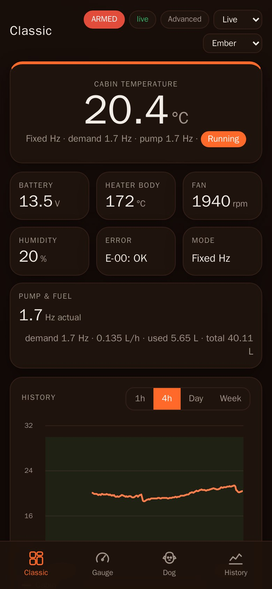
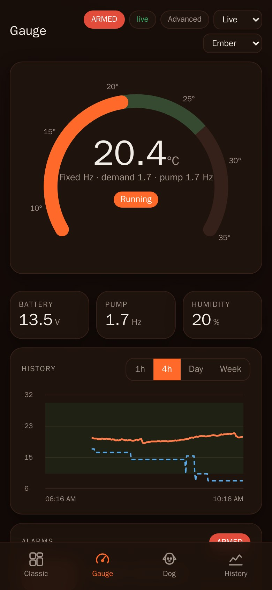
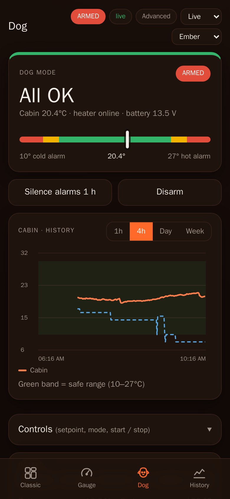
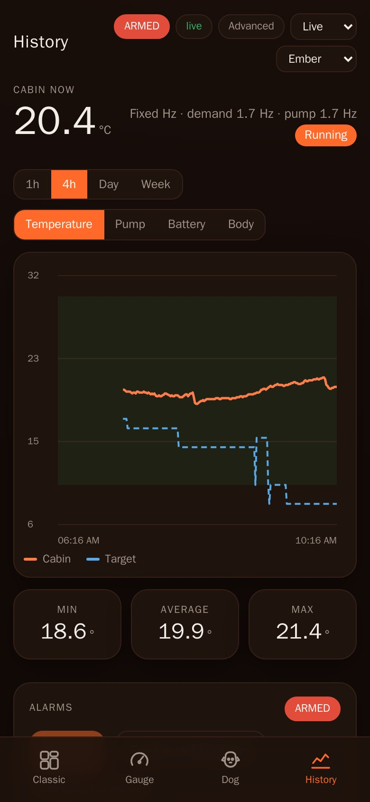
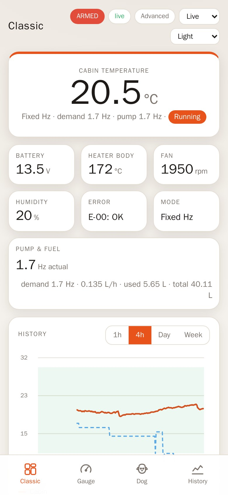
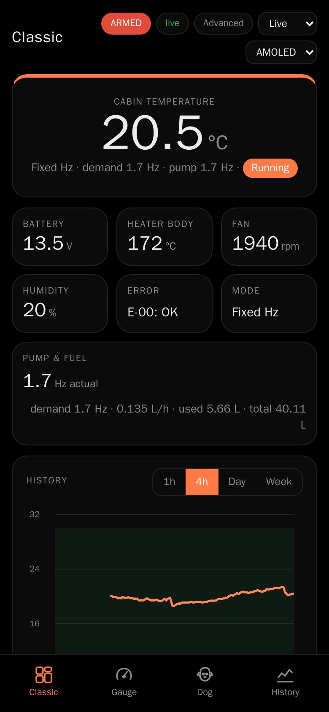
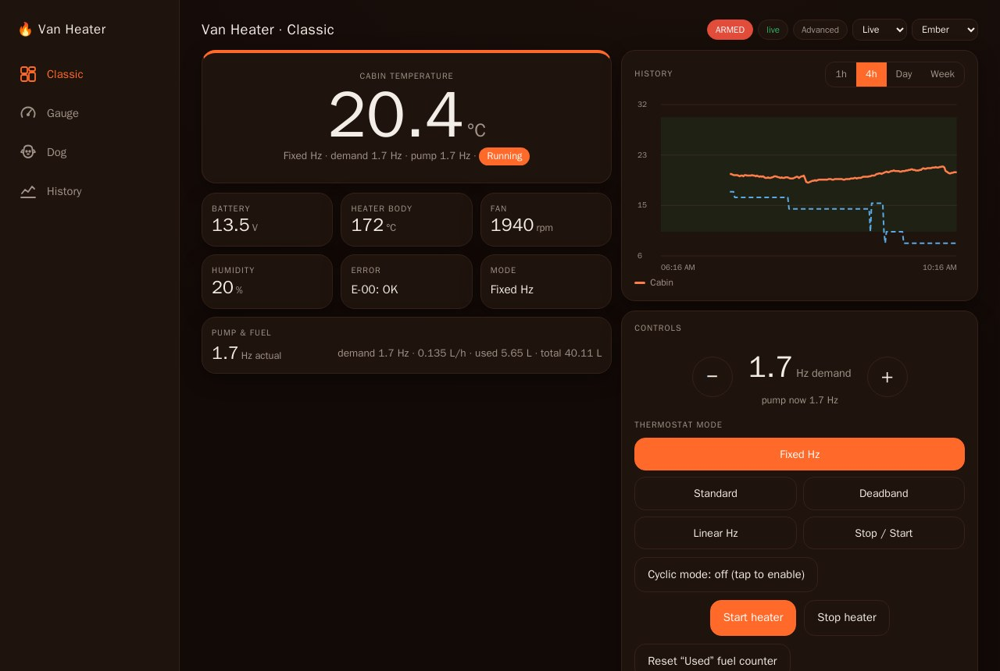
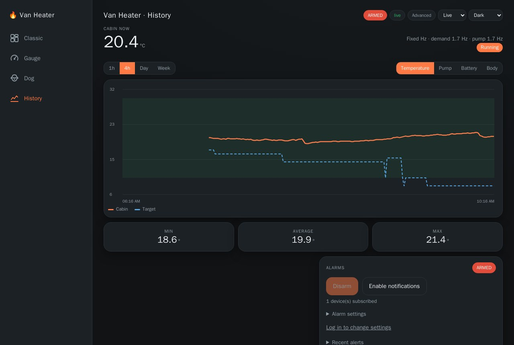
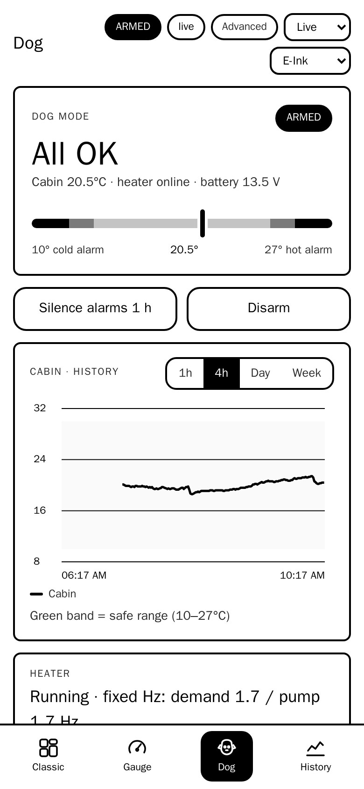
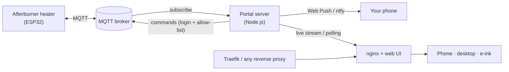

<div align="center">

# 🔥 Van Heater

**A fast, good-looking web portal for an Afterburner diesel heater, with a built-in alarm for when the dog is in the van.**

Live temperatures · push alarms · full remote control · works on phones, desktops and e-ink

<br>

&nbsp;
&nbsp;


<sub>Real screenshots of the running portal: Classic, Gauge and Dog layouts.</sub>

<sub>An unofficial companion portal for the <a href="https://www.mrjones.id.au/afterburner/">Afterburner</a> diesel heater controller. Not affiliated with or endorsed by that project.</sub>

[](LICENSE)

</div>

---

## Why this exists

The stock Afterburner web page is a great controller, but it only works while its tab is open. This portal adds the part that matters when you leave a dog in the van: **a server that watches the heater around the clock and sends a push notification the moment the cabin gets too hot, too cold, loses contact, or the heater reports a fault.** It also replaces the stock page with a faster, mobile-first dashboard you can leave open on a phone, a desktop or a fixed display.

It talks to the heater over the same MQTT topics the stock page uses, so the original page keeps working alongside it.

## Features

### Dashboard
- **Live data**: cabin temperature, target, heater state, battery voltage, body temperature, fan speed, humidity, pump rate, fuel rate, fuel used and lifetime total.
- **Four layouts** you switch between from the menu (bottom bar on phones, sidebar on desktop):
  - **Classic**: everything at a glance.
  - **Gauge**: a thermostat dial with the target marked.
  - **Dog**: a big "All OK" / alarm status with the cabin temperature on a bar between your two alarm limits.
  - **History**: a large, touch-readable chart with min/average/max.
- **Fixed Hz aware**: in Fixed Hz mode the target is a pump demand, not a temperature. The portal shows the *demanded* Hz next to the *actual* pump Hz and flags when they differ.
- **7 days of history** (1 h / 4 h / day / week) for cabin and target temperature, battery, heater body and pump rate.
- **Six themes**: Auto, Ember, Dark, AMOLED, Light and E-Ink.
- **Adjustable update interval**: live stream, or poll every 5 s to 5 min to save battery on e-ink and other fixed displays. Updates pause while the page is hidden.

<p align="center">
&nbsp;
&nbsp;

</p>

<p align="center"><sub>History view · Light theme · AMOLED theme</sub></p>

### Alarms (the reason for the server)
- Runs **on the server**, so it keeps watching when no browser is open. The heater itself knows nothing about it.
- Rules: **too hot**, **too cold**, **no data from the heater**, **heater offline**, **heater error** and **low battery**.
- Each rule has its own limit and a "must persist for N minutes" delay so a brief spike never wakes you. Alarms clear with a margin (hysteresis) and repeat at an interval you choose.
- **Dog mode** arms the temperature, no-data and offline rules. Heater errors and low battery are always on.
- **Notifications** by Web Push (installable PWA, works on Android and desktop browsers), with an optional [ntfy](https://ntfy.sh) channel as a backup. A "silence repeats for 1 hour" action is built into the notification.

### Control
- Setpoint (°C, or pump demand in Fixed Hz mode), **thermostat mode** (Fixed Hz, Standard, Deadband, Linear Hz, Stop/Start), **cyclic mode**, **start/stop** and a **reset for the "Used" fuel counter** (never the lifetime total).
- Everything that changes the heater **asks for confirmation first**, and the modes that can stop and restart the heater carry an explicit warning.
- Only an allow-listed set of commands can ever be sent. Anything else is refused by the server.

### Advanced settings page
- **Portal connection** (the broker this website uses) is editable. A new connection is tested first and only adopted if heater data arrives on it.
- **Heater MQTT settings** are shown **read-only** on purpose: changing them would disconnect the heater.
- Thermostat, frost mode and start/power settings are shown read-only for now.

<p align="center">

</p>

<p align="center"><sub>The same dashboard on a desktop, with the controls card visible after login.</sub></p>

<p align="center">

</p>

### Built for fixed displays
The **E-Ink** theme is pure black on white with no colour, no animation and no shadows, with heavy outlines and larger type. Alarm states are shown as inverted black banners and grey tones instead of colour.

<p align="center">

</p>

## How it works



- The **server** subscribes to the heater's topics, keeps 7 days of history on disk, evaluates the alarm rules every 10 seconds and sends notifications. It only publishes to MQTT from the authenticated command endpoint.
- The **web UI** is plain static files with no build step, served by nginx. It also runs on any ordinary web server in a read-only "direct" mode that connects to the broker straight from the browser.
- Everything runs in **Docker Compose**.

## Getting started

You need Docker, an MQTT broker the heater already publishes to, and the heater's topic prefix (shown on its comms settings page).

```bash
git clone https://github.com/guillaumedemeyere/dieselheater.git
cd dieselheater
cp .env.example .env          # fill in MQTT_HOST, MQTT_PORT, MQTT_TLS and MQTT_TOPIC_PREFIX
./tools/set-password.sh       # sets the admin password (only a hash is stored)
docker compose up -d --build
```

Open <http://localhost:8088>. Reading the dashboard needs no login. Controls and alarm settings need the admin password, and the session lasts 30 days on a device.

### Configuration

| Variable | What it does |
|---|---|
| `MQTT_HOST`, `MQTT_PORT`, `MQTT_TLS` | Broker the server connects to (TCP, usually TLS on 8883). |
| `MQTT_USER`, `MQTT_PASSWORD` | Optional broker credentials. |
| `MQTT_TOPIC_PREFIX` | The heater's topic prefix. |
| `ADMIN_PASSWORD_HASH` | Written by `tools/set-password.sh`. |
| `COMMANDS_ENABLED` | `false` (default) is a **dry run**: commands are validated and logged but never sent. Set `true` to allow control. |
| `NTFY_URL` | Optional ntfy topic URL as a second alert channel. |
| `VAPID_SUBJECT` | Optional contact URL for the push service. |
| `WEB_PORT` | Host port for the web UI (default 8088). |

For a public address, put it behind a reverse proxy with HTTPS. Web Push needs HTTPS. Commented Traefik labels are included in `docker-compose.yml`.

### Run the tests

```bash
cd server && npm install && npm test
```

## AI assistance

This project was built with the help of an AI coding assistant. The maintainer set the requirements, made the design decisions and tested the result on their own heater. The assistant wrote much of the code and the unit tests.

What that means for you:
- **It has not been independently audited.** The unit tests cover the alarm rules and the command allow-list only. Most of the rest was checked by hand.
- **Heater commands deserve extra care.** Start/stop, thermostat modes and cyclic mode have not been tried on a real heater, as listed under [Status](#status). Review `server/src/commands.js` before enabling `COMMANDS_ENABLED`.
- **Do not use it as your only safety measure** for people, animals or property.

Bug reports and fixes are welcome.

## Safety and security

- **This controls a fuel-burning heater. Use it at your own risk.** The alarms are an aid, not a replacement for checking on your animals.
- **Restart-capable features are deliberately cautious.** Start/Stop, the Stop/Start thermostat mode and cyclic mode can stop and restart the heater, which can produce smoke. Each asks for confirmation and warns you.
- **A public broker is not private.** On a public broker such as `broker.emqx.io`, anyone who learns your topic prefix can read the heater and send it commands. Treat the prefix like a password, never publish it, and consider enabling the heater's PIN option (not supported by this portal yet).
- **The portal limits what it exposes.** Logged-out visitors only receive the dashboard values. Network details and anything password-like are never sent to them or stored. Login uses a scrypt-hashed password, a signed 30-day cookie and a lockout after repeated failures.
- **Keep your own settings out of git.** `.env` is ignored. Never commit your topic prefix, admin hash or screenshots that show them.

## Project layout

```
server/        Node.js service: MQTT, alarm engine, push, login, commands, history
  src/         index.js · engine.js · commands.js · push.js · auth.js · store.js
  test/        unit tests for the alarm engine and the command allow-list
web/           static UI: index.html · app.js · alarms.js · controls.js · settings.html
  legacy/      the previous layout, kept as a fallback
deploy/        nginx configuration
tools/         set-password.sh · sniff.sh (read-only MQTT capture)
docs/          protocol.md (the MQTT messages this portal uses) and the screenshots
mockups/       design mock-ups used to choose the layouts
LICENSE        MIT
```

## Status

Built and checked against a real heater: the dashboard, all four layouts and six themes, history, alarms with push, login, the setpoint (including Fixed Hz), and the advanced settings page.

Built but not yet tested against a real heater: Start/Stop, the thermostat modes other than the current one, and cyclic mode.

Not built yet: editing frost mode, timers and start settings; support for the heater's MQTT PIN; a dedicated page for old e-ink browsers.

## Contributing

Issues and pull requests are welcome, with the understanding that this is a hobby project with no support promise. Please do not commit firmware images, copies of the stock Afterburner web page, or anything specific to your own heater (topic prefix, addresses, passwords).

## Credits and licence

This project is **not affiliated with or endorsed by** the [Afterburner](https://www.mrjones.id.au/afterburner/) project, whose heater controller it works with. The MQTT messages it uses are described in [docs/protocol.md](docs/protocol.md); they were worked out by observing a heater's traffic and how the stock web page behaves, and no code from that page is included. "Afterburner" is the name of that project and is used here only to say what this software works with.

Released under the [MIT License](LICENSE). Use it at your own risk: it controls a fuel-burning heater and must not be relied on as a safety device.
